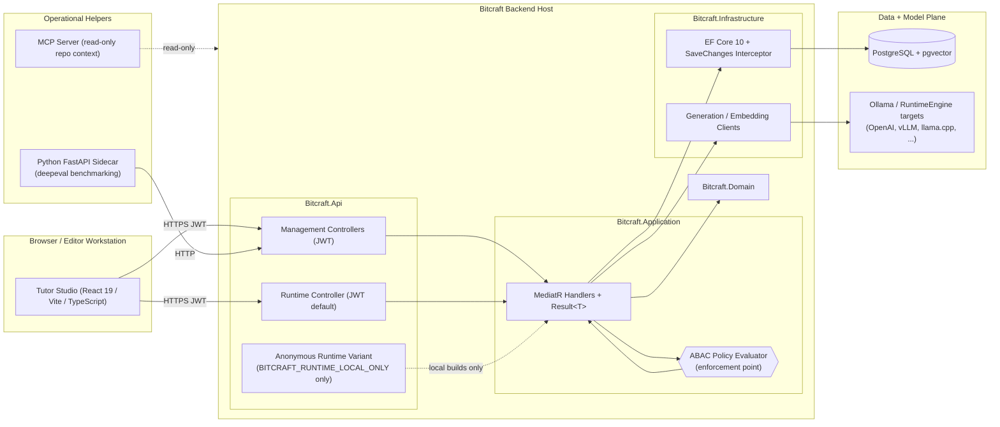
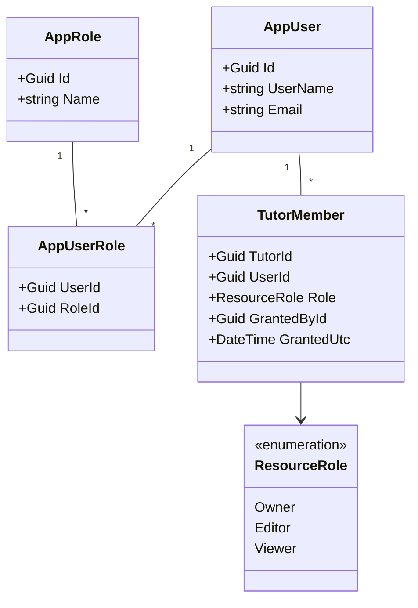
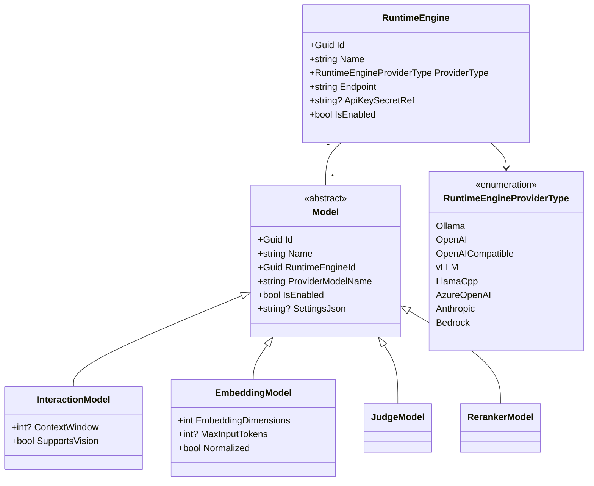
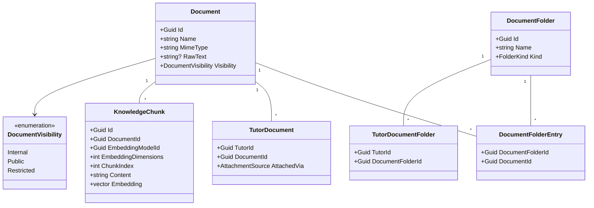
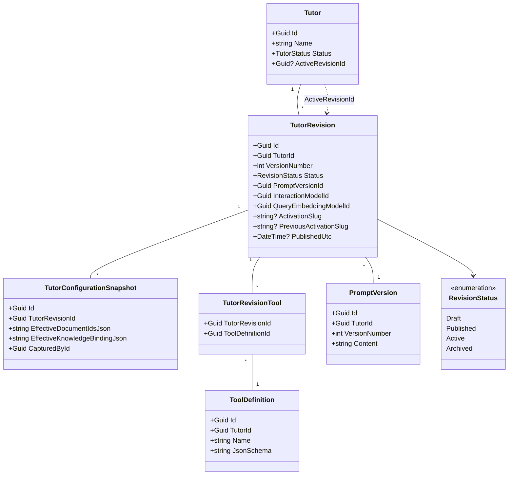
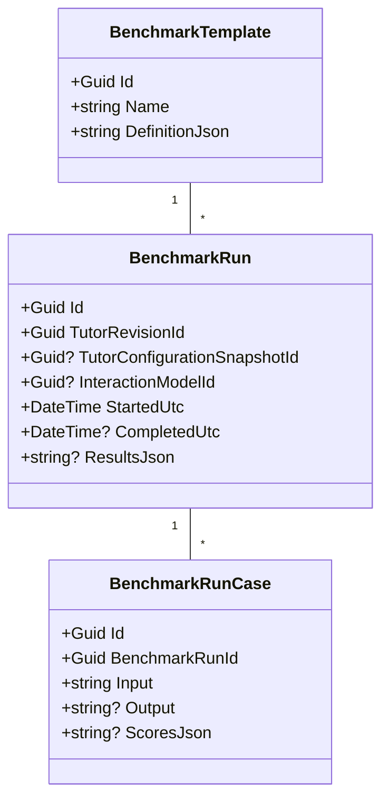
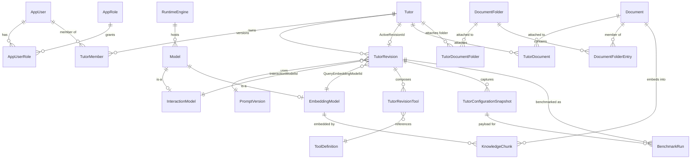
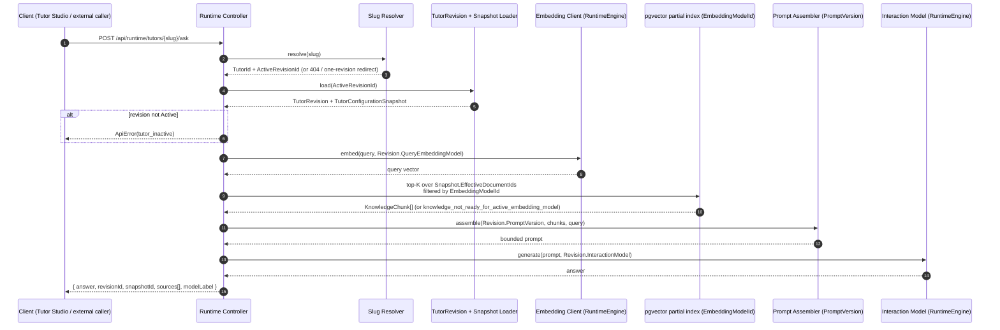

# Bitcraft Architecture (Living Document)

> **Owner**: Typewriter (writes), Lead Dev (reviews), Planner (cross-checks against locked decisions).
> **Updated**: every accepted ERM, contract, or stack-shape change.
> **Scope**: this is the team-facing architecture document. Locked decisions live in [plan.decisions.md](../.github/plans/feature-freeze-2026-05-21/plan.decisions.md); this document explains the **resulting system** in terms developers can apply day-to-day. Decision IDs in this document (e.g. D1, D5.a) are the persistent identifiers used in `plan.yaml.locked_decisions` and the register.

## 1. Vision and Constraints

Bitcraft is an agentic AI Tutor management platform. The product lets administrators manage runtime engines and models, lets editors author tutors backed by retrieval-augmented knowledge, and lets activated tutors answer questions through a deterministic Core API runtime endpoint. The shipped system is a modular monolith — a .NET 10 Clean Architecture backend ([src/Bitcraft.Api](../src/Bitcraft.Api), [src/Bitcraft.Application](../src/Bitcraft.Application), [src/Bitcraft.Infrastructure](../src/Bitcraft.Infrastructure), [src/Bitcraft.Domain](../src/Bitcraft.Domain)) sitting on PostgreSQL with the pgvector extension, plus a React/Vite client at [tutor-studio/](../tutor-studio) and an out-of-process Python FastAPI [sidecar/](../sidecar) used for deepeval benchmarking.

Tenancy is **single-tenant per deployment** (D0a): one Bitcraft instance serves one customer with one database. Multi-owner link tables such as `TutorMember` are an internal Clean Architecture pattern, not a multi-tenancy boundary, and no `TenantId` columns exist anywhere in the schema (see [plan.erm.md §1](../.github/plans/feature-freeze-2026-05-21/plan.erm.md#1-principles)).

The deployment doctrine is the [Twelve-Factor App](https://12factor.net/) (D0b). The Bitcraft-specific compliance map lives at [.github/governance/twelve-factor.md](../.github/governance/twelve-factor.md). Configuration and secrets follow 12-Factor Config (D9): environment variables for production-bound deployments and a `template.<file>.<ext>` convention reserved for tracked samples that genuinely need to ship with the repository.

Authorization is **ABAC throughout** (D1, [NIST SP 800-162](https://csrc.nist.gov/Projects/Attribute-Based-Access-Control)). The fixed global roles `Admin`, `Editor`, and `Auditor` defined in [AppRoles.cs](../src/Bitcraft.Application/Common/Security/AppRoles.cs) are coarse subject attributes. Resource attributes — `TutorMember.ResourceRole`, `TutorRevision.Status`, `Document.Visibility` (D1.a), the runtime build flag, environment attributes — drive the actual decision through a single centralized policy evaluator in the Application layer. Controllers may shape requests and translate `Result<T>` to HTTP, but they do not branch on resource attributes themselves.

The runtime trust boundary is set at compile time, not at runtime configuration. The Runtime API authenticates with JWT by default; the only anonymous code path exists when the `BITCRAFT_RUNTIME_LOCAL_ONLY` MSBuild constant is defined for the active build configuration (D8). Non-local builds physically exclude the anonymous controller variant from the compiled assembly. There is no runtime switch — and no misconfiguration — that can expose anonymous access in a shipped build.

## 2. System Overview

Three trust zones coexist. The **browser zone** runs Tutor Studio and reaches the backend exclusively over authenticated HTTPS; JWTs live in client memory for the freeze. The **backend host zone** owns the management surface, the JWT-required runtime surface, and (only in builds with `BITCRAFT_RUNTIME_LOCAL_ONLY`) a separate anonymous controller variant intended for local development and benchmarking. The **data and model plane** holds PostgreSQL/pgvector and whichever upstream model runtime is registered as a `RuntimeEngine` (D11/D11.a). Operational helpers — the deepeval sidecar and the read-only MCP server — sit alongside but never bypass the Application boundary.

The ABAC policy evaluator (D1) is the single enforcement point. Every command and query that touches a resource passes through it, so controllers never see policy logic and infrastructure never sees policy logic; both surface their results back through `Result<T>` to the API layer for HTTP translation.

## 3. Bounded Contexts

The Domain layer is partitioned into five contexts. Each subsection links back to its canonical ERM section in [plan.erm.md](../.github/plans/feature-freeze-2026-05-21/plan.erm.md) for the authoritative shape.

### 3.1 Identity & Access

- **Invariants**: every `Tutor` has at least one `TutorMember` with `Role = Owner` at all times; founding membership is inserted in the same transaction as `Tutor` creation.
- **Subject attributes**: global role (`Admin` / `Editor` / `Auditor`).
- **Resource attributes**: `TutorMember.ResourceRole`, presence of any membership row for `(TutorId, UserId)`.
- **Cross-link**: [plan.erm.md §3](../.github/plans/feature-freeze-2026-05-21/plan.erm.md#3-identity-and-access).

### 3.2 Modeling & Runtime Engines

- **Invariants**: `RuntimeEngine` delete is `Restrict` while any `Model` references it; `EmbeddingModel.EmbeddingDimensions` is required and drives partial-index lifecycle (§4).
- **UI-surfaced providers** (D11.a): `Ollama`, `OpenAI`, `OpenAICompatible`, `vLLM`, `LlamaCpp`. Reserved (defined, not surfaced): `AzureOpenAI`, `Anthropic`, `Bedrock`.
- **Cross-link**: [plan.erm.md §5](../.github/plans/feature-freeze-2026-05-21/plan.erm.md#5-modeling-context--runtimeengine) and [§5b](../.github/plans/feature-freeze-2026-05-21/plan.erm.md#5b-modeling-context--abstract-model-tph).

### 3.3 Documents & Knowledge

- **Invariants**: `Document` is tutor-agnostic (no `TutorId`, no `OwnerId`); `DocumentFolder` is an administrative grouping only — the runtime never reads folders (D4, D4b). Unique `(DocumentId, EmbeddingModelId, ChunkIndex)` on `KnowledgeChunk`.
- **First ABAC resource attribute** (D1.a): `Document.Visibility` enum, default `Internal`; `Public` and `Restricted` are reserved (defined, not surfaced).
- **Cross-link**: [plan.erm.md §4](../.github/plans/feature-freeze-2026-05-21/plan.erm.md#4-document-context) and [§6](../.github/plans/feature-freeze-2026-05-21/plan.erm.md#6-knowledge-context).

### 3.4 Tutoring & Revisions

- **Invariants**: at most one `Active` revision per tutor (activating archives the previous Active in the same transaction); revision fields are immutable once the revision leaves `Draft`; `Tutor.ActiveRevisionId` is the canonical runtime lookup pointer.
- **Activation slug** (D22, D22.a): `ActivationSlug` lives on the activation record (the `Active` `TutorRevision`), **not** on `Tutor`. `PreviousActivationSlug` retains the one-revision redirect window.
- **Resource attributes**: `TutorRevision.Status` is the access discriminator for editor-vs-runtime operations.
- **Cross-link**: [plan.erm.md §7](../.github/plans/feature-freeze-2026-05-21/plan.erm.md#7-tutoring-context).

### 3.5 Benchmarking

- **Invariants**: every `BenchmarkRun` is keyed off a `TutorRevisionId` (D6); the optional `TutorConfigurationSnapshotId` carries the materialized payload used by the run. The sidecar consumes contracts only; it never touches the database directly.
- **Cross-link**: [plan.erm.md §8](../.github/plans/feature-freeze-2026-05-21/plan.erm.md#8-benchmarking-context).

## 4. Entity-Relational Model

### 4.1 Cardinality matrix

Mirrors [plan.erm.md §9](../.github/plans/feature-freeze-2026-05-21/plan.erm.md#9-cardinality-and-cascade-summary).

| Source | Target | Cardinality | On-delete |
|---|---|---|---|
| AppUser ↔ Tutor (via TutorMember) | M:N | Cascade link rows; Restrict user delete while memberships exist |
| Model → RuntimeEngine | N:1 | Restrict |
| Tutor ↔ Document (via TutorDocument) | M:N | Cascade link rows; Restrict on Document |
| Tutor ↔ DocumentFolder (via TutorDocumentFolder) | M:N | Cascade link rows; Restrict on Folder |
| DocumentFolder ↔ Document (via DocumentFolderEntry) | M:N | Cascade link rows; Restrict on Document |
| Tutor → PromptVersion | 1:N | Cascade |
| Tutor → ToolDefinition | 1:N | Cascade |
| Tutor → TutorRevision | 1:N | Restrict (history preserved) |
| TutorRevision → TutorRevisionTool | 1:N | Cascade |
| TutorRevision → PromptVersion | N:1 | Restrict |
| TutorRevision → Model (Interaction) | N:1 | Restrict |
| TutorRevision → Model (Embedding) | N:1 | Restrict |
| Document → KnowledgeChunk | 1:N | Cascade |
| EmbeddingModel → KnowledgeChunk | 1:N | Restrict (guided purge first) |
| Tutor → TutorConfigurationSnapshot | 1:N | Restrict |
| TutorRevision → TutorConfigurationSnapshot | 1:N | Restrict |
| Tutor → BenchmarkRun | 1:N | Restrict |
| BenchmarkRun → BenchmarkRunCase | 1:N | Cascade |

### 4.2 pgvector specifics

`KnowledgeChunk.Embedding` is an **untyped** pgvector `vector` column — no fixed `vector(N)` — so embeddings produced by different `EmbeddingModel` rows can coexist in the same table (D5, [pgvector README](https://github.com/pgvector/pgvector)). A database-level `CHECK (vector_dims(Embedding) = EmbeddingDimensions)` rejects mismatched inserts as defense-in-depth alongside Application validation. The `EmbeddingDimensions` column is denormalized onto the chunk so query routing and per-model index targeting do not need to join back to `Model`.

ANN index strategy is configurable per deployment, with **HNSW as the default** and IVFFlat as the supported alternative (D5.a). Both strategies are realized as **partial expression indexes keyed on `EmbeddingModelId`**, so each enabled embedding model gets its own dedicated index sized to its own dimensions. The Application commands `EnableEmbeddingModelCommand` and `DisableEmbeddingModelCommand` read the deployment-level ANN setting at execution time and call Infrastructure helpers to create or drop the index transactionally. Switching strategies later requires disabling and re-enabling the embedding model so the right index variant is built. Distance operator is standardized on cosine for the freeze.

## 5. API Surface

| Controller group | Route prefix | Auth | Notes |
|---|---|---|---|
| Identity & users | `/api/identity`, `/api/users` | JWT (Management) | Login, role administration, bootstrap-driven seeding (no hard-coded admin). |
| Settings & RuntimeEngines | `/api/admin/settings`, `/api/admin/runtime-engines` | JWT (Management, `Admin`) | Engine CRUD; secrets returned only as `ApiKeySecretRef`. |
| Models | `/api/admin/models` | JWT (Management, `Admin`) | TPH-aware payloads keyed by `ModelType`; embedding-only validation server-side. |
| Documents & Folders | `/api/documents`, `/api/folders` | JWT (Management, `Editor`+) | Plain text only for freeze; membership-checked through the ABAC evaluator. |
| Knowledge | `/api/knowledge` | JWT (Management, `Editor`+) | Vectorization scoped by `(Document, EmbeddingModel)`; partial index helper invoked. |
| Tutors & Revisions | `/api/tutors`, `/api/tutors/{id}/revisions` | JWT (Management) | Revision state machine, activation, snapshot capture. |
| Benchmarking | `/api/benchmarks` | JWT (Management) | Shell endpoints for the freeze; statistics deferred. |
| Runtime (default) | `/api/runtime/tutors/{activationSlug}/ask` | JWT (Runtime) | Always present; ABAC evaluator enforces revision-status and membership. |
| Runtime (anonymous variant) | same shape | none | **Only compiled when** `BITCRAFT_RUNTIME_LOCAL_ONLY` MSBuild constant is defined (D8). Absent from non-local builds. |

API contracts live under [src/Bitcraft.Api/Contracts](../src/Bitcraft.Api/Contracts) and are immutable C# records. Request payloads are suffixed `*Request`, responses `*Response`, and no Domain entity is ever returned across the wire. Per [api-contracts.instructions.md](../.github/instructions/api-contracts.instructions.md), failures are translated from the Application `Result<T>` into a typed `ApiError { code, message, details? }` shape so the frontend can branch on stable error codes (see §9) instead of HTTP status alone. Mapping between contracts and Application requests lives in [src/Bitcraft.Api/Mapping](../src/Bitcraft.Api/Mapping).

## 6. Application Layer (CQRS)

The Application layer is MediatR-based. Commands and queries return `Result<T>` (success carrier plus typed failure code) and the Api layer is the only place that translates those failures into HTTP. Handlers do not throw for expected failures; they return `Result.Failure(code)` and let the controller-level mapper produce the right status and `ApiError` body. This keeps the Application surface free of `HttpContext` references and makes handlers trivially unit-testable.

The ABAC policy evaluator (D1, D1.a) is the single resource-access enforcement point. **Recommended placement, pending Sec Ops confirmation (Open Decision O5)**: an `IPolicyEvaluator` interface under `src/Bitcraft.Application/Common/Authorization/`, with a default implementation that composes subject attributes (current user's global role, `TutorMember.ResourceRole` for the resource), resource attributes (`TutorRevision.Status`, `Document.Visibility`, etc.), action descriptors, and environment attributes (build flag, request origin) into a single `PolicyDecision`. Handlers call the evaluator before any mutation or sensitive read; controllers never branch on policy themselves.

Audit columns (`CreatedUtc`, `CreatedById`, `ModifiedUtc`, `ModifiedById`) defined on [BaseModel](../src/Bitcraft.Domain/Common/BaseModel.cs) are populated by an EF Core `SaveChanges` interceptor in Infrastructure (D10, [EF Core interceptor docs](https://learn.microsoft.com/ef/core/logging-events-diagnostics/interceptors#savechanges-interceptor)). The interceptor reads the current principal from a scoped `ICurrentUser` abstraction so that no handler has to remember to stamp audit fields. Future iterations will layer a Message-History-style audit log on top of this; the interceptor stays in place as the lower-level guarantee.

## 7. Frontend Architecture (Tutor Studio)

| Concern | Library | Decision |
|---|---|---|
| Framework | React 19 + Vite 8 | baseline |
| Language | TypeScript (migrating now) | D18, D18.a |
| Server state | TanStack Query v5 | D14 |
| Client-only state | Redux Toolkit (narrowed) | D14 |
| Forms | React Hook Form + Zod | D15 |
| Data tables | TanStack Table v8 (headless) | D16 |
| Design system | react-bootstrap 5.3 | D20 |
| File/Folder admin UI | `@svar-ui/react-filemanager` (retain unless re-evaluation forces replacement) | D17 |
| Testing | Vitest + @testing-library/react | D19 |

Tutor Studio is migrated to TypeScript in the locked order **Settings → ModelCatalog → Tutors → Files → Benchmarking** (D18.a). Shared modules (`store/`, API client, hooks) migrate only after at least three pages are converted so the extracted types come from real usage. `strict: true` and `noUncheckedIndexedAccess` are enabled at the end of the migration to avoid a wall of errors mid-flight. Until OpenAPI codegen stabilizes (Open Decision O3), hand-written TypeScript clients live next to the converted pages, typed from the same Zod schemas the forms use.

Document and Folder UI is **administrative only** (D4b, D17). Editors and admins use the Folders page to group documents and attach folders to tutors; the runtime never sees a folder. At attach time the UI surfaces a read-only "Resolved documents" preview so editors can see exactly what the next activation Snapshot (D23) will materialize. End-user file uploads at chat time are explicitly out of PoC scope and will be modeled as a separate runtime concept, not as folders.

## 8. Activation and Runtime Flow

Slug resolution reads from the activation record, not from `Tutor`: per D22.a, `ActivationSlug` lives on the `Active` `TutorRevision` and `PreviousActivationSlug` provides the one-revision redirect window after a rename. The effective document set the runtime sees is the one **materialized into the Snapshot at activation time** (D23); documents and folder attachments mutated after activation do not affect the active runtime until the next activation captures a new Snapshot.

### 8.1 Runtime configuration source of truth

`ITutorRuntime` is the single Application-layer execution path for interactive chat and automatic benchmark output generation. The revision remains the human-managed identity and lifecycle record, while its activation snapshot is the immutable execution payload: snapshot prompt content, provider model name, interaction parameters, effective document IDs, and effective embedding bindings take precedence over mutable live values. The revision deployment payload is also captured in that snapshot for provenance; current Ollama connectivity still resolves through the referenced `RuntimeEngine`. Live prompt, model, and engine rows are loaded only to validate tutor ownership, revision status, referential consistency, enabled state, and supported connectivity. An Active revision without its matching snapshot fails closed; it never falls back to all documents owned by the caller.

`TutorDocument` and `TutorDocumentFolder` are the canonical tutor-knowledge attachment entities. `KnowledgeSourceLink` is retained only as an explicit compatibility read path for records written by older clients; current attachment endpoints write `TutorDocument`, and effective-set resolution de-duplicates legacy and canonical rows before activation. Activation materializes the exact direct and folder-derived document IDs plus their embedding-model bindings into the snapshot. Runtime pgvector searches are restricted to that captured set and the captured embedding-model identity.

Interactive requests resolve `Tutor.ActiveRevisionId`, create or resume a snapshot-pinned PostgreSQL conversation, and pass only the current turn to the server. Agent Framework session JSON and normalized messages are durable; a bounded `ChatHistoryProvider` projection controls model context without deleting product history. Automatic benchmark generation delegates to the same `ITutorRuntime`, selecting its explicit Published or Active revision and bound snapshot, so it cannot drift into a separate prompt, retrieval, memory, or tool pipeline. The run persists its revision, snapshot, interaction model, retrieval flag and TopK; the referenced immutable snapshot contains prompt, provider model, embedding bindings and tool configuration. Optional per-case benchmark context is evaluator input and does not replace runtime retrieval.

Infrastructure uses Microsoft Agent Framework `ChatClientAgent` as the tutor execution and orchestration layer. Microsoft.Extensions.AI provides the provider-neutral chat messages, options, function tools, middleware, usage and streaming types behind the Application-owned `ITutorAgentExecutor` boundary. `RuntimeChatClientFactory` routes Ollama through OllamaSharp, OpenAI and compatible runtimes through the OpenAI SDK adapter, and Anthropic through the isolated stable compatibility adapter. RAG and tutor-scoped long-term memory are execution-scoped `AIContextProvider` implementations; both inject bounded user-role data with explicit untrusted-content instructions. Snapshot tools resolve only registered built-in handlers. Approved HTTP and tutor MCP kinds fail closed, and the developer `/mcp-server/` is outside the runtime trust boundary.

The canonical production flow is API → Application tutor use case → `ITutorRuntime` → `ITutorAgentExecutor` → Infrastructure `ChatClientAgent` → context providers/tools → selected `IChatClient`. SSE streaming and non-streaming calls share that path, session update, error mapping, safe telemetry, cancellation, and provider timeout behavior. Bitcraft remains responsible for tutors, revisions, snapshots, permissions, model/runtime configuration, knowledge ownership, benchmarks, conversations, deployment and product behavior. Agent Framework does not own those product rules. See [agent-framework-foundation.md](agent-framework-foundation.md) for provider limitations and operational detail.

## 9. Cross-Cutting Concerns

**Logging and tracing.** Backend uses `ILogger` with safe structured identifiers and emits OpenTelemetry-compatible `ActivitySource`/`Meter` signals for tutor execution. The MEAI client is wrapped by `OpenTelemetryChatClient` with sensitive-data capture disabled. Telemetry includes tutor/revision/snapshot/conversation IDs, provider/model, retrieval and tool counts, latency, outcome, and available token counts; it excludes prompt/message/document/memory text, images, session JSON, endpoints, credentials, and authorization headers. Sidecar and developer MCP server retain their separate operational logging.

**Error codes.** Failures cross the API boundary as `ApiError { code, message, details? }` with stable `code` strings the frontend branches on. Initial vocabulary: `tutor_inactive`, `knowledge_not_ready_for_active_embedding_model`, `revision_not_editable`, `membership_required`, `runtime_engine_disabled`, `embedding_dimensions_mismatch`, `slug_conflict`. New codes are added by Application handlers and surfaced through the Api mapping layer; controllers never invent codes.

**Configuration and secrets.** All configuration follows 12-Factor Config (D9). The full per-factor status, including the `BITCRAFT_RUNTIME_LOCAL_ONLY` build-stage classification under Factor V and the `BootstrapOptions`/env-vars-first plan under Factor III, lives in [.github/governance/twelve-factor.md](../.github/governance/twelve-factor.md). Secret material is never persisted in a database column; `ApiKeySecretRef` columns hold a logical key resolved against the deployment secret store.

**Migration strategy.** Schema evolution is the 8-step dependency-ordered sequence in [plan.erm.md §10](../.github/plans/feature-freeze-2026-05-21/plan.erm.md#10-migration-sequencing) (D21): Identity vocabulary → resource membership → RuntimeEngine → Model TPH → Tutor-Document M:N → dynamic-dimension Knowledge → Tutor revisions → benchmark FK realignment. Each migration is reviewable in isolation; humans run `dotnet ef migrations add ...` per [AGENTS.md](../AGENTS.md) — agents do not.

## 10. Reference Knowledgebase

Curated index of authoritative external sources used in decisions. Source of truth for URLs is [plan.decisions.md](../.github/plans/feature-freeze-2026-05-21/plan.decisions.md); this section restates them grouped for developer convenience.

> Secretary curation (2026-05-20): added the 12-Factor sub-page links (Config, Build/Release/Run), the MSBuild conditional-compilation reference used by D8, the Microsoft RAG concepts page referenced by D4b, and the TypeScript strict-mode handbook page referenced by D18.a. No external sources are introduced beyond those already cited in [plan.decisions.md](../.github/plans/feature-freeze-2026-05-21/plan.decisions.md).

- ABAC: [NIST SP 800-162](https://csrc.nist.gov/Projects/Attribute-Based-Access-Control)
- Twelve-Factor: [12factor.net](https://12factor.net/), [Config](https://12factor.net/config), [Build, release, run](https://12factor.net/build-release-run); Bitcraft compliance map at [.github/governance/twelve-factor.md](../.github/governance/twelve-factor.md)
- EF Core: [M:N](https://learn.microsoft.com/ef/core/modeling/relationships/many-to-many), [Inheritance](https://learn.microsoft.com/ef/core/modeling/inheritance), [SaveChanges interceptor](https://learn.microsoft.com/ef/core/logging-events-diagnostics/interceptors#savechanges-interceptor), [Migrations](https://learn.microsoft.com/ef/core/managing-schemas/migrations)
- pgvector: [README](https://github.com/pgvector/pgvector)
- Retrieval-augmented generation: [Microsoft RAG concepts](https://learn.microsoft.com/azure/search/retrieval-augmented-generation-overview)
- Temporal modeling: [Fowler — Patterns for Modeling Time](https://martinfowler.com/eaaDev/timeNarrative.html)
- Auditing future: [EIP — Message History](https://www.enterpriseintegrationpatterns.com/patterns/messaging/MessageHistory.html)
- Tenancy: [Azure SaaS app design patterns](https://learn.microsoft.com/azure/azure-sql/database/saas-tenancy-app-design-patterns)
- ASP.NET Core auth: [Authorization](https://learn.microsoft.com/aspnet/core/security/authorization/introduction)
- Build-time trust boundary: [MSBuild conditional compilation symbols](https://learn.microsoft.com/dotnet/csharp/language-reference/preprocessor-directives#conditional-compilation)
- Frontend: [TanStack Query](https://tanstack.com/query/latest), [TanStack Table](https://tanstack.com/table/latest), [React Hook Form](https://react-hook-form.com/), [Vitest](https://vitest.dev/), [TypeScript](https://www.typescriptlang.org/), [TypeScript handbook — strict mode](https://www.typescriptlang.org/tsconfig/#strict)

## 11. Revision History

- 2026-05-20 — scaffold introduced by Planner alongside feature-freeze v3.
- 2026-05-20 — bodies populated by Typewriter (§1–§9; Mermaid diagrams added; v3.1 minor locks D1.a, D5.a, D11.a, D18.a, D22.a folded in).
